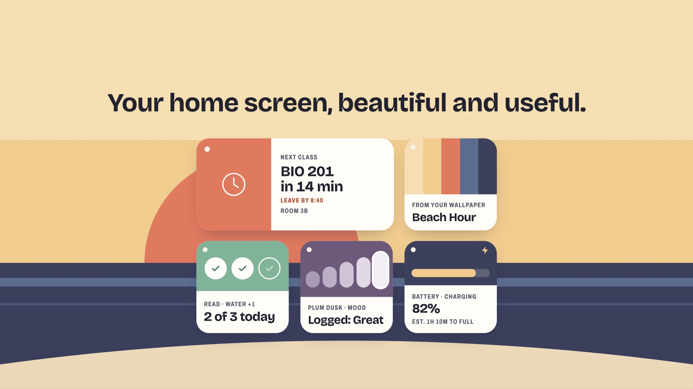
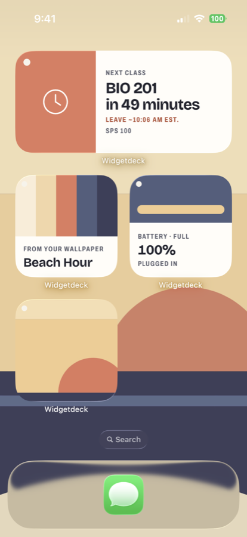
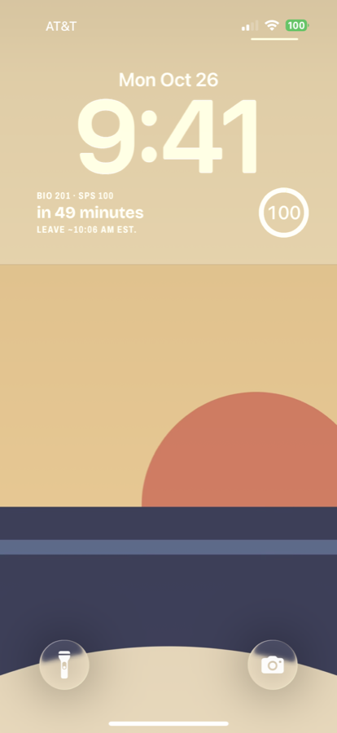
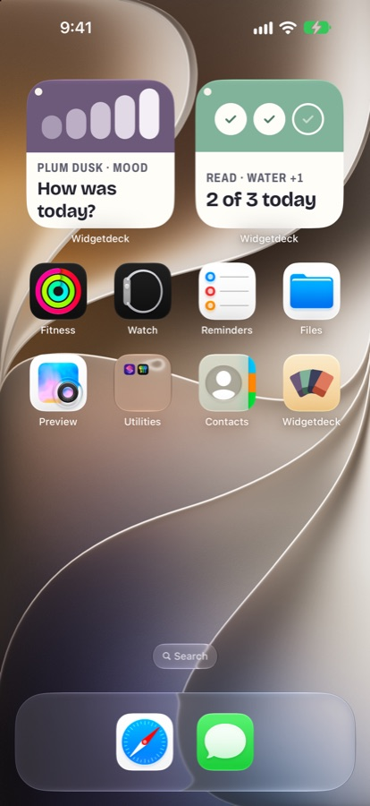
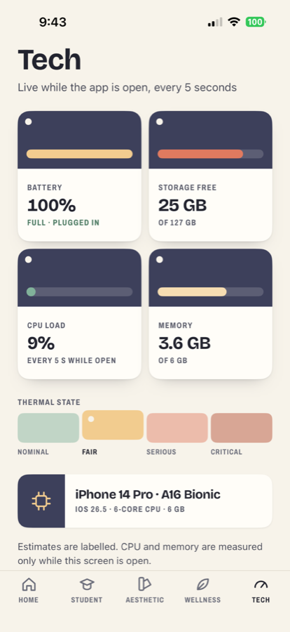
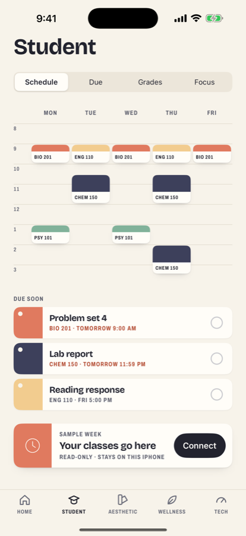
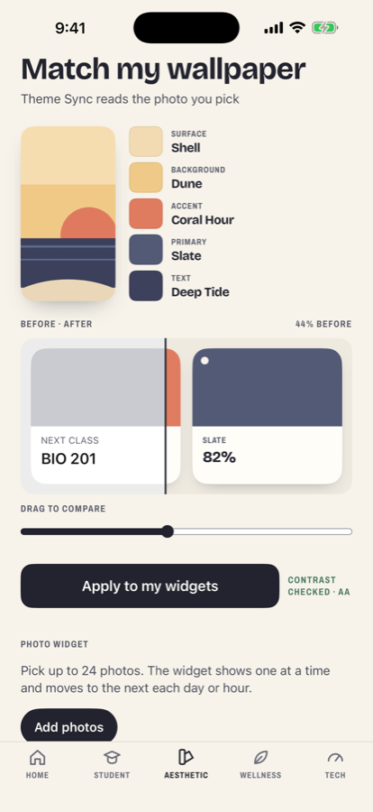
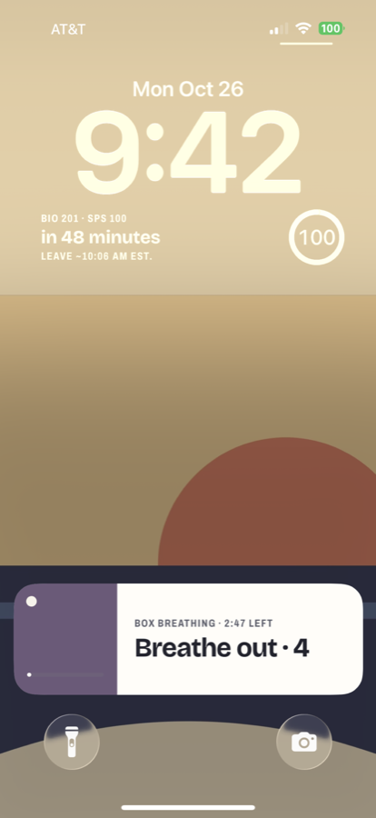
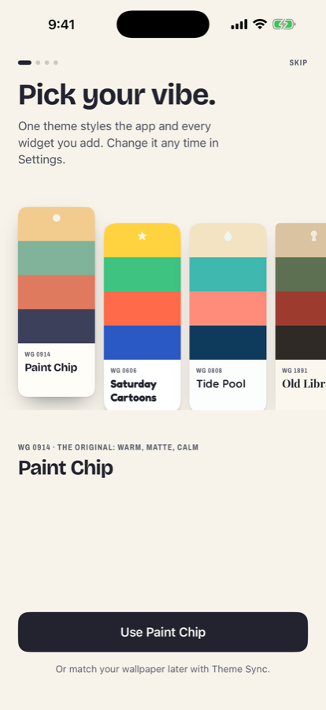
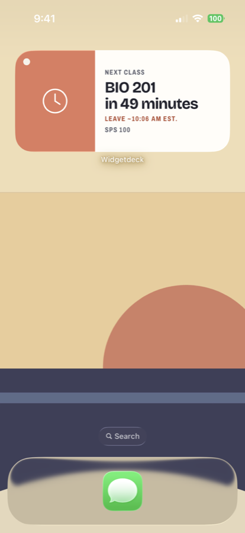

<div align="center">



# Widgetdeck

**One app for your whole home screen: beautiful *and* useful iOS widgets.**

Tech · Student · Aesthetic · Wellness

[](https://apps.apple.com/app/id6816573831)


[](LICENSE)

</div>

Widgetdeck is a **free, non-commercial hobby project**: no purchases, subscriptions, ads, analytics or tracking.
Everything is built with SwiftUI, WidgetKit, ActivityKit and App Intents, and there is not a single third-party dependency.

<div align="center">

<video src="https://github.com/MineProDan/widgetdeck/raw/main/docs/readme/reel.mp4" poster="docs/readme/banner.jpg" controls muted loop playsinline width="100%"></video>

<sub>If the video doesn't play, <a href="docs/readme/reel.mp4">open the 15 second reel</a>.</sub>

</div>

## A look

<table>
  <tr>
    <td width="33%"></td>
    <td width="33%"></td>
    <td width="33%"></td>
  </tr>
  <tr>
    <td align="center"><b>Home Screen</b><br>widgets that look like paint chips</td>
    <td align="center"><b>Lock Screen</b><br>next class and leave time</td>
    <td align="center"><b>Interactive</b><br>tick a habit or log a mood from the widget</td>
  </tr>
</table>

## Four sections

<table>
  <tr>
    <td width="25%"></td>
    <td width="25%"></td>
    <td width="25%"></td>
    <td width="25%"></td>
  </tr>
  <tr>
    <td align="center"><b>Tech</b></td>
    <td align="center"><b>Student</b></td>
    <td align="center"><b>Aesthetic</b></td>
    <td align="center"><b>Wellness</b></td>
  </tr>
</table>

- **Tech:** battery with an estimated time to full, storage, thermal state, and an in-app CPU/RAM snapshot. Public APIs only, and every estimate is labelled.
- **Student:** class schedule from your calendar, "leave by" travel alerts, reminders, assignments, GPA and a "what do I need on the final" predictor, focus timers with a Live Activity.
- **Aesthetic:** photo and mood-board widgets, **Theme Sync** (pick your wallpaper, get a matching palette with contrast checked), ten theme decks, optional borders and effects.
- **Wellness:** habits with streaks, mood logging, daily quotes and affirmations, guided breathing with a Dynamic Island Live Activity.

15 widgets across the Home Screen and Lock Screen, in light, dark, tinted and clear modes.

<table>
  <tr>
    <td width="50%"></td>
    <td width="50%"></td>
  </tr>
</table>

## Honest by design

iOS has hard limits, and Widgetdeck doesn't pretend otherwise:

- Widgets are **not real-time**. They show precomputed timelines and self-updating timers. "Live" only happens in the app and in Live Activities.
- There is no public API for GPU usage, battery health or other apps' activity, so none of it is shown.
- Apps can't read your wallpaper, so Theme Sync works from a photo you pick.
- The widget extension never touches the network or CloudKit. It reads small snapshots the app writes.
- Your data stays on your device and in your own private iCloud. See the [privacy policy](docs/AppStore/).

## How it's built

```
App/                 app shell: Home, onboarding, settings
WidgetExtension/     widget bundle, Live Activities, App Intents
Packages/
  CoreKit/           models, Core Data + CloudKit, snapshots, imaging, permissions (no UI)
  DesignSystem/      the Paint Chip design system: tokens, fonts, components, widget chrome
  TechFeature/  StudentFeature/  AestheticFeature/  WellnessFeature/
```

- Local Swift packages hold all real code. Features never import each other; cross-section data goes through CoreKit snapshot types.
- Core Data with CloudKit private database sync, App Group snapshots for widgets.
- Swift Testing for unit tests, Swift 6 strict concurrency, zero warnings.
- The visual language is documented in [`DESIGN.md`](DESIGN.md) and the product thinking in [`PRODUCT.md`](PRODUCT.md).

## Building

- Xcode 27.1 (iOS 27.1 SDK), deployment target iOS 17.0, Swift 6
- Open `App.xcodeproj`, choose the `WidgetX` scheme (code identifiers keep the app's earlier name) and run
- Signing, App Group, iCloud container and bundle IDs belong to the original developer (`io.github.mineprodan.iospremium`). To run on your own device, change them in the project and in `Packages/CoreKit/Sources/CoreKit/Support/AppIdentifiers.swift`

### Tests

```bash
xcodebuild test -project App.xcodeproj -scheme WidgetX -destination 'platform=iOS Simulator,name=iPhone 17 Pro'
```

Each package also has its own tests (`xcodebuild test -scheme <Package>-Package` inside `Packages/<Package>`).

## Docs

- [`PRODUCT.md`](PRODUCT.md): who it's for · [`DESIGN.md`](DESIGN.md): the Paint Chip visual system
- [`docs/plan/`](docs/plan/): the original plan · [`docs/AppStore/`](docs/AppStore/): privacy policy, privacy label and release checklist

## Contributing

It's a hobby project, but issues and pull requests are welcome. Please keep it free: no paywalls, ads, tracking or third-party SDKs.

## License

[MIT](LICENSE). Bundled fonts (Bricolage Grotesque, Archivo) are under the SIL Open Font License; see the `OFL-*.txt` files in `Packages/DesignSystem/Sources/DesignSystem/Resources/Fonts/`. Quotes are public domain.
